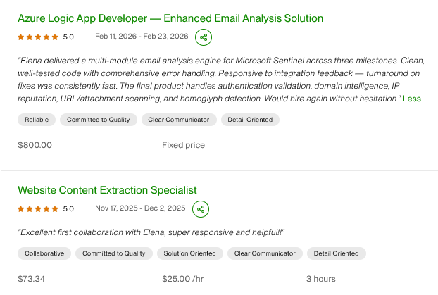

# Elena Gusarevich | Python Backend & Automation Engineer

**Focus:** cloud security automation, backend services, scraping & anti-bot pipelines, Telegram infrastructure  
**Impact:** 10,800+ subscribers across bot-driven channels · 100+ users of my own SaaS · production Microsoft Sentinel workflows  
🟢 **Available for remote contracts** · Uruguay (UTC−3)

---

## 💼 What I Do

I build production-grade Python systems: asynchronous backend services, cloud security pipelines, data-extraction infrastructure and automation that keeps working when real-world data and third-party services don't.

- **Security automation on Microsoft Azure** — Sentinel and Defender XDR analytics, KQL, MSTICPy, threat-intelligence enrichment, incident automation
- **Backend services** — FastAPI, SQLAlchemy, PostgreSQL, Kafka, async workers, clean architecture (Ports & Adapters)
- **Scraping & anti-bot automation** — SeleniumBase UC Mode, Playwright, proxy authentication, CAPTCHA and SMS verification flows
- **Telegram products** — bots, userbots, paid subscriptions with Telegram Stars, multi-channel distribution

I care about deterministic behaviour, idempotent processing, graceful degradation and test coverage — and I use AI-augmented development (Claude Code, Cursor) to move fast without lowering the bar.

---

## 💼 Work Experience

### Python Security & Cloud Automation Engineer — Private Practice
**Nov 2026 – Present** · Remote · Contract (B2B)

- **Detection fine-tuning:** offline Python analytics pipeline that ingests, normalizes and evaluates historical Microsoft Sentinel and Defender XDR telemetry, ranks noisy rules and validates candidate exclusions against malicious overlap.
- **Threat hunting automation:** cross-domain correlation notebooks in Azure ML with MSTICPy and KQL, multi-source IoC enrichment (MISP, VirusTotal) and incident creation.

### Python Backend Developer — QLAN
**Jun 2026 – Oct 2026** · Remote · Full-time

- Asynchronous backend services and data-processing pipelines for automated media extraction across social platforms (FastAPI, SQLAlchemy, PostgreSQL, Kafka).
- Containerized microservice infrastructure with Docker, Kubernetes, Helm, Linux and MinIO/S3.
- Focus on production reliability, graceful error recovery and maintainability.

### Python Automation Engineer | Backend Developer — Private Practice
**Jan 2024 – Jun 2026** · Remote · Contract

- **Security automation:** modular phishing analysis engine for Microsoft Sentinel incident response with multi-source reputation checks and deterministic risk scoring.
- **Bot ecosystem:** distributed system of Telegram bots (Aiogram, Telethon) with fuzzy deduplication, content filtering, paid subscriptions and Linux/Docker deployment.
- **Anti-bot automation:** browser automation pipelines with SeleniumBase UC Mode and runtime-generated Chrome extensions for authenticated proxies.
- **SaaS backend:** Ritma, a privacy-first FemTech platform with Telegram and Android clients.
- **Data engineering:** ETL pipelines for US automotive auction data from dynamic websites and PDFs into Excel and Google Sheets.

### Art Lead 3D | Senior Environment Artist — NDA Online PC Game
**Mar 2024 – Oct 2024**

- Led a cross-functional team of 15 specialists: production workflows, technical documentation, estimation and delivery schedules.
- Built Python automation tools for Blender and Unreal Engine.

---

## 🛠 Technical Skills

| Area | Tools |
| :--- | :--- |
| **Core** | Python 3.10+, AsyncIO, OOP, Clean Architecture |
| **Backend** | FastAPI, SQLAlchemy, Alembic, REST APIs, async workers, service layer, repository pattern |
| **Data & Messaging** | PostgreSQL, MongoDB, Kafka, Redis, ETL pipelines, background jobs |
| **Cloud & DevOps** | Microsoft Azure, Azure Functions, Azure ML, Docker, Kubernetes, Helm, Linux, Systemd, CI/CD |
| **Microsoft Security** | Microsoft Sentinel, Defender XDR, KQL (Kusto), MSTICPy, Threat Hunting, MITRE ATT&CK |
| **Threat Intelligence** | MISP, VirusTotal API, Abuse.ch, URLhaus, MalwareBazaar, WHOIS, DNSBL, GeoIP |
| **Analytics & ML** | pandas, Plotly, SHAP, Isolation Forest, `merge_asof`, Streamlit, risk scoring |
| **Automation & Web** | SeleniumBase (UC Mode), Playwright, scraping infrastructure, session handling |
| **Telegram** | Aiogram 3, Telethon, python-telegram-bot, Telegram Stars payments |
| **Mobile** | Kotlin, Jetpack Compose, Android, WorkManager |
| **Testing & AI** | pytest, pytest-asyncio, pytest-cov (90%+), Claude Code, Cursor, LLM validation |
| **Languages** | Python, SQL, Bash, Kotlin, JavaScript, basic Go |

---

## 🚀 Featured Projects

Full case studies live in my [portfolio](https://hel-3d.github.io/hel-3d/projects.html).

### 🧠 [Threat Hunting Notebook Suite for Microsoft Sentinel & XDR](https://hel-3d.github.io/hel-3d/projects/projects_sentinel_threat_hunting_notebooks.html)
**Problem:** Analysts traced attacks by hand across three Defender consoles.  
**Solution:** Azure ML notebooks that correlate Email > Endpoint > Cloud events per account with time-bounded `merge_asof()` joins, map them to MITRE ATT&CK, enrich IoCs (MISP > Microsoft TI > VirusTotal) and detect anomalies with Isolation Forest + SHAP.  
**Impact:** Both milestones approved by the client on first submission; validated on 117,000+ real telemetry events.  
**Tech:** Python, Azure ML, MSTICPy, KQL, pandas, scikit-learn, SHAP, Plotly, PyMISP

### 🛡 [Email Analysis Engine for Microsoft Sentinel](https://hel-3d.github.io/hel-3d/projects/projects_email_analysis_engine_for_microsoft_sentinel.html)
**Problem:** Suspicious emails in Sentinel incidents needed automated phishing analysis.  
**Solution:** Azure-agnostic Python engine with SPF/DKIM/DMARC checks, WHOIS, DNSBL, GeoIP, SafeLinks unwrapping, homoglyph detection, URLhaus/MalwareBazaar and config-driven scoring.  
**Impact:** Deployed in the client's Sentinel automation pipeline · 87% test coverage · 5.0 Upwork review  
**Tech:** Python, Azure Functions, Logic Apps, dnspython, geoip2, rapidfuzz, pytest

### 💚 [Ritma — Privacy-First Cycle Tracking SaaS & Android App](https://hel-3d.github.io/hel-3d/projects/projects_ritma_notification_engine_saas.html)
**Problem:** Cycle trackers rarely respect privacy or support partner-aware notifications.  
**Solution:** Hexagonal backend with shared use cases behind a FastAPI gateway and a Telegram adapter; native offline-first Android client with an encrypted outbox and idempotent sync.  
**Impact:** Live on [Google Play](https://play.google.com/store/apps/details?id=com.ritma.app) and [Telegram](https://t.me/RitmaOn_bot) · 965 backend + 87 Android tests · 90% coverage · EN/ES/RU  
**Tech:** Python, FastAPI, AsyncIO, MongoDB, Docker, Kotlin, Jetpack Compose, WorkManager

### 🤖 [GameDev Vacancy Distribution Bots](https://hel-3d.github.io/hel-3d/projects/projects_gamedev_vacancy_distribution_bots.html)
**Problem:** GameDev vacancies are scattered across dozens of noisy Telegram channels.  
**Solution:** Telethon ingestion with filtering and fuzzy deduplication, moderated publishing, and a paid personal feed with keyword filters and Telegram Stars subscriptions.  
**Impact:** 5,300+ subscribers on [Telegram](https://t.me/works_gamedev) · 5,500+ members on [VK](https://vk.ru/works_gamedev)  
**Tech:** Python, Aiogram 3, Telethon, PostgreSQL, asyncpg, Telegram Stars

### 📥 [Hel_inst_bot — Social Media Downloader for Telegram](https://hel-3d.github.io/hel-3d/projects/projects_hel_media_downloader_bot.html)
**Problem:** Sharing social-media content in Telegram means sending links people can't open.  
**Solution:** Platform-specific handlers with a shared delivery layer for 13 platforms, in private chats and as a group administrator.  
**Impact:** Live at [@Hel_inst_bot](https://t.me/Hel_inst_bot) · continuously maintained  
**Tech:** Python, Telegram Bot API, yt-dlp, gallery-dl, Instaloader

### 🔐 [Registration & SMS Verification Automation](https://hel-3d.github.io/hel-3d/projects/projects_bot_protection_sms_verification_automation.html)
**Problem:** Automating registration on protected React SPAs with phone verification.  
**Solution:** SeleniumBase UC Mode, JavaScript-driven React inputs, runtime Manifest V3 proxy extension, RuCaptcha and CoreCluster OTP polling with failure artifacts.  
**Impact:** Paid test task followed by paid work on the live pipeline · [open repository](https://github.com/hel-3d/automation-case-sms)  
**Tech:** Python, Selenium, SeleniumBase, RuCaptcha API, CoreCluster API

### 🎯 [Telegram Promo Campaign Bot (Lunar Hare)](https://hel-3d.github.io/hel-3d/projects/projects_telegram_promo_campaign_bot_lunar_hare.html)
**Problem:** An offline retail activation needed abuse-resistant reward delivery.  
**Solution:** QR > photo upload > AI photo verification > channel subscription check > one-time promo code.  
**Impact:** Ran live for the campaign on my own server · [open repository](https://github.com/hel-3d/promo-campaign-telegram-bot)  
**Tech:** Python, aiogram, SQLite, OpenAI API

---

## 📊 GitHub Activity

  

---

## 💡 How I Work

✅ **Production mindset** — idempotent processing, restart safety, logging and graceful degradation by default  
✅ **Specification-driven** — I build to acceptance criteria, and flag where the spec itself is wrong  
✅ **Tested** — up to 90%+ coverage on core logic, with tests built from real-world edge cases  
✅ **Security-aware** — no secrets in code, least-privilege access, privacy-first data handling  
✅ **Leadership background** — led a 15-person cross-functional team before moving into engineering

---

### ⭐⭐⭐⭐⭐ Client Feedback (Upwork)

  

---

## 📫 Let's Connect

💼 **LinkedIn:** [linkedin.com/in/helena-gusarevich](https://www.linkedin.com/in/helena-gusarevich/)  
📧 **Email:** hel.async.dev@gmail.com  
💬 **Telegram:** [@Hel_inst](https://t.me/Hel_inst)  
🌐 **Portfolio:** [hel-3d.github.io/hel-3d](https://hel-3d.github.io/hel-3d/)  
📄 **Resume:** [PDF](https://hel-3d.github.io/hel-3d/Elena_Gusarevich_Python_Automation_Engineer_Resume.pdf)  
🌍 **Location:** Uruguay (UTC−3) · Remote worldwide

---

  

  <i>Building production-grade automation systems that work reliably under real-world conditions</i>

